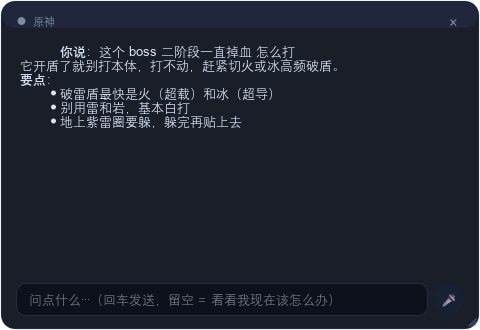
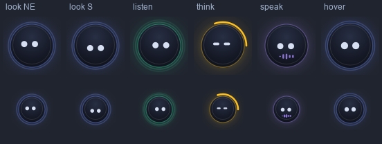
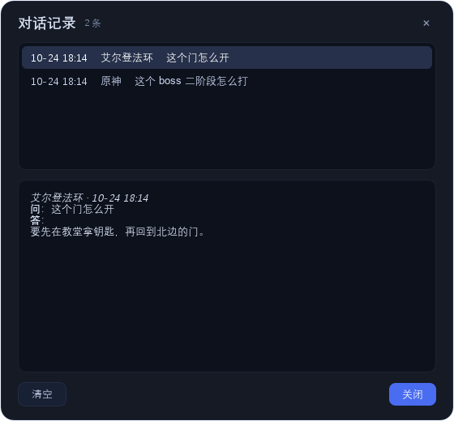
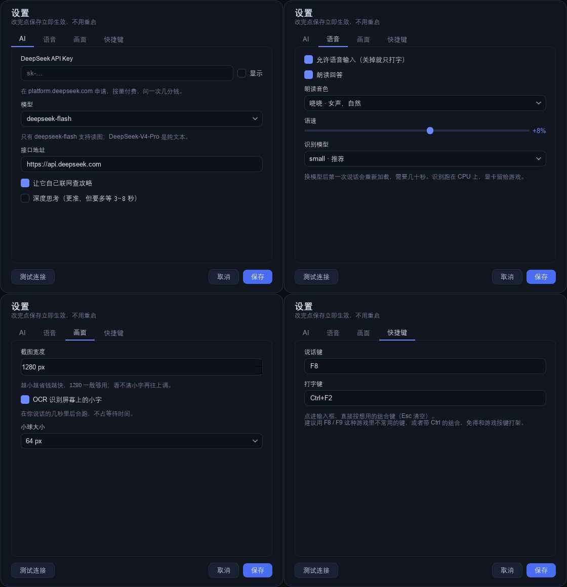
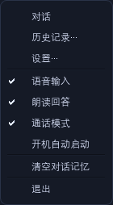

# 功能介绍

> 给第一次接触这个项目的人看的：它到底能做什么、怎么用、有什么代价。
> 想看实现细节的，去 [架构设计](架构设计.md) 和 [运行说明](运行说明.md)。


## 一句话

一个常驻桌面的悬浮球，游戏中按一下热键说句话，它会**看一眼你的屏幕**、查攻略、然后**用语音回答你**。

适合的场景：

- 打 BOSS 打不明白，想立刻知道机制
- 卡在某个任务，不知道去哪交
- 装备/属性看不懂，想让人解释一下
- 单纯想边玩边问两句，不想切出去搜网页

不适合的场景：

- 竞技类 FPS（覆盖层有风险，见文末免责）
- 需要连续操作的实时战斗（它回答有 5 秒左右延迟）

## 两种模式

**游戏模式**（默认）：快。5 秒内出声，看画面答题。

**办公模式**：能操作电脑。跑命令、改文件、查资料，一个任务 5~60 秒。

切换：托盘右键「办公模式」，或设置 → 办公。球的样式会从**圆形光圈**变成**方形边框**，一眼能分清。

办公模式的权限默认锁在工作区（`文档\语音助手\workspace`）里，越界的写入会被直接拒绝。任务运行中按 F8 可以停止。

## 核心能力

### 1. 语音对话

按 `F8`（可改）说一句话，**静音 0.78 秒自动结束**，不用按住、不用再说一次「结束」。

之后是这条链路：

```
识别你的话 → 抓一帧屏幕 → 交给模型 → 边说边显示答案
```

它说话的时候，你随时可以再按一次热键**打断**，它立刻闭嘴开始听。

### 2. 通话模式（唤醒词）

打开后麦克风常开，喊一句就能触发：

> 「小助手，这个 BOSS 二阶段怎么打」

**唤醒词和问题一句说完**，不用先喊一声等应答。如果你只喊了唤醒词（「小助手」），它会先回一句「主人，我在」，然后等你说问题。

- 唤醒词和应答语都能在设置里改，应答可以留空（不出声）
- 它录音、思考、朗读期间会自动暂停监听，**不会自己把自己唤醒**
- 唤醒判断只在**本机**做，音频不上传

### 3. 看得见画面

它抓的是**前台窗口本身**（不是整屏，旁边的聊天窗口不会被拍进去），只抓一帧，不做常驻录屏。

两个通道同时给模型：

| 通道 | 作用 |
|---|---|
| 截图（压到 1280 宽） | 看懂场景、UI、位置关系 |
| OCR（原分辨率） | 认出精确的名字：BOSS 全名、装备属性、任务标题 |

OCR 是必要的：截图压缩后小字会糊，模型容易把「灰烬峡谷」读成「灰爆峡谷」，而攻略检索恰恰靠这些字。



### 4. 会查攻略

模型没把握时会自己调 DeepSeek 的搜索接口，检索词里带游戏名。答案会附带来源，气泡里能点开。

可以关掉（设置 → AI → 联网查攻略），关掉后只靠模型自己的知识。

### 5. 悬浮球 / 桌宠

- **眼睛跟着鼠标转**，闲着会自己瞟两眼
- 会眨眼；鼠标凑近会睁大；按下去有回弹
- 四种状态用颜色 + 眼睛形状双编码：听（绿，睁大）/ 想（黄，眯眼）/ 说（紫，嘴型波形）/ 待机（蓝）
- 可拖动，位置会记住



### 6. 对话记录

每次问答存一条到 `data/history.jsonl`（本机）。点气泡上的 🕘 打开记录窗口，分两页：

- **对话**：每次问答，能翻、能清空
- **办公任务**：审计日志，记下发起方式（语音/打字）、权限、确认结果、跑过哪些命令、成没成、多久



### 7. 设置

四页：AI、语音、画面、快捷键。**保存立即生效**，不用重启。



## 一次完整交互

```
你按下 F8
    ├─ 开始录音（同时后台抓屏 + OCR，不占等待）
    └─ 你说话，停顿 0.78 秒后自动结束
                ↓
        本地识别出文字（约 1.4 秒）
                ↓
    截图 + 屏幕文字 + 你的问题 → DeepSeek
                ↓
    首字约 1.6 秒 → 气泡逐字显示
                ↓
    按句切开 → 合成语音 → 边生成边播
```

实测「说完 → 听见第一声」约 **5.2 秒**。之后是连续的，念第一句时第二句已经在合成。

## 快捷键与入口

| 操作 | 默认 | 说明 |
|---|---|---|
| 说话 | `F8` | 点一下开始，静音自动结束 |
| 切换模式 | `Ctrl+F9` | 游戏 ⇄ 办公 |
| 打断 | 同上 | 朗读中按说话键即打断 |
| `Esc` | — | 关气泡，焦点还给游戏 |
| 右键小球 | — | 对话 / 游戏模式（Ctrl+F9）/ 按键说话（F8）/ 设置 / 退出 |
| 托盘图标 | — | 双击打开对话，右键同一套菜单 |



## 配置项

界面里都能改，这里是字段含义（`config/settings.json`）：

| 字段 | 默认 | 说明 |
|---|---|---|
| `api_key` | 空 | DeepSeek API Key |
| `model` | `deepseek-flash` | 唯一支持读图的模型 |
| `hotkey` | `F8` | 说话键 |
| `mode_hotkey` | `Ctrl+F9` | 切换游戏/办公 |
| `max_image_width` | 1280 | 截图宽度，越小越省钱越快 |
| `allow_search` | 开 | 允许联网查攻略 |
| `think` | 关 | 深度思考，更准但慢 3~8 秒 |
| `voice_enabled` | 开 | 语音输入总开关 |
| `tts_enabled` | 开 | 朗读回答 |
| `tts_voice` | 晓晓 | 朗读音色（4 款，可试听） |
| `tts_rate` | +8% | 语速 |
| `asr_model` | small | base 更快 / medium 更准 |
| `ocr_enabled` | 开 | 后台 OCR |
| `wake_word` | 小助手 | 通话模式唤醒词 |
| `wake_ack` | 主人，我在 | 唤醒应答，留空不出声 |
| `call_mode` | 关 | 通话模式 |
| `orb_size` | 64 | 球大小 |

## 数据与隐私

**会离开你电脑的：**

- 截图（压缩后）和 OCR 文字 → 发送到 DeepSeek，用于理解和答题
- 你的问题文字 → 同上
- 回答文字 → 发送到微软 Edge TTS 合成语音
- 语音检索词 → 发到 DeepSeek 搜索接口

**只留在本机的：**

- 你的**录音**（只在本地识别，不上传）
- 唤醒词判断（同上）
- 对话记录 `data/history.jsonl`
- 办公审计 `data/office_audit.jsonl`
- 配置 `config/settings.json`（含 API Key，注意别整个文件夹发人）

## 费用

`deepseek-flash` 输入 ¥1 / 百万 token、输出 ¥4 / 百万 token（空闲时段），一张截图最多算 1024 token。

问一次几分钱。搜索接口 ¥5 / 千次。语音识别和朗读不花钱（本地 + Edge TTS 免费）。

## 常见问题

**Q：为什么它盖不住我的游戏？**
独占全屏（Exclusive Fullscreen）下任何普通窗口都盖不上去，这是 DWM 的设计。把游戏设成「无边框窗口」或「窗口化全屏」即可。

**Q：第一次用语音要等很久？**
要下载 whisper 模型（约 250MB），只有第一次。之后程序启动 12 秒会在后台预加载。

**Q：说话它没反应？**
先看托盘图标在不在。再看设置里的「语音输入」有没有开。麦克风被别的程序占用也会失败，气泡里会有提示。

**Q：通话模式老是误触发？**
游戏声外放会被当成「有人在说话」。戴耳机，或者把唤醒词换成更少见的词。

**Q：能不用语音吗？**
可以。关掉语音输入，点球打开输入框打字，一样能看图答题。

## 免责声明

本项目**只读截屏**，不注入、不 hook、不模拟键鼠。
但部分竞技游戏对任何覆盖层都敏感，使用前请自行评估账号风险。